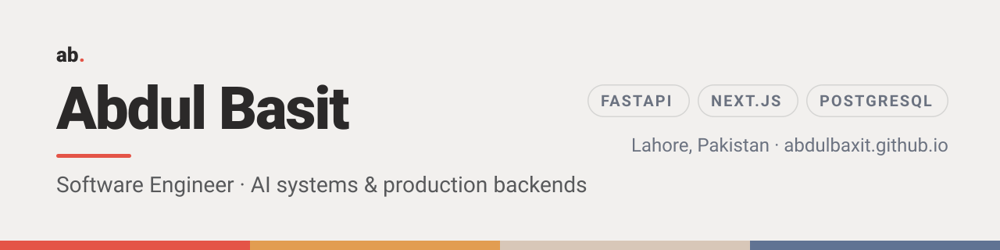

<picture>
  <source media="(prefers-color-scheme: dark)" srcset="assets/banner-dark.png" />
  
</picture>

## About

Software Engineer based in Lahore, Pakistan. I build AI systems and the backends
that carry them into production — LLM pipelines, multi-tenant APIs, background-job
infrastructure — along with the full-stack applications on top of them.

Currently building **[Implement AI](https://implementai.io)** at Techanzy, and
client platforms at [Voltade](https://voltade.com/) part-time.

## Selected work

| Project | Context | Outcome |
|---|---|---|
| **[Implement AI](https://abdulbaxit.github.io/work/implement-ai/)** | AI SaaS platform · Techanzy | Multi-tenant APIs and background jobs, shipped via Docker and GitHub Actions |
| **[Legiflow](https://abdulbaxit.github.io/work/legiflow/)** | AI for legal documents · Devsarch | 40% less manual review time; answers come only from the case file in scope |
| **[LLM Evaluator](https://abdulbaxit.github.io/work/llm-evaluator/)** | Model evaluation · client: Turing | Grades tool-calling models on database state, not on transcripts |
| **[Talkspresso](https://abdulbaxit.github.io/work/talkspresso/)** | Booking and payments platform | Built and shipped end to end as the only developer |
| **[Happy Fish](https://abdulbaxit.github.io/work/happy-fish/)** | Client platform · Voltade | Customer and subscription management, live in production |
| **[The Doorman Game](https://github.com/Abdulbaxit/club-gatekeeper-ai)** | Personal project · FastAPI · React | Two LLM agents: a doorman you must talk your way past, and a hidden judge that scores you |

Seven case studies → **[abdulbaxit.github.io](https://abdulbaxit.github.io/#works)**

## Latest notes

<!-- BLOG-POST-LIST:START -->
- [Testing LLM tool calls against the database, not the transcript](https://abdulbaxit.github.io/notes/testing-llm-tool-calls-against-the-database/)
- [Keeping a RAG chatbot inside one case file](https://abdulbaxit.github.io/notes/keeping-a-rag-chatbot-inside-one-case-file/)
<!-- BLOG-POST-LIST:END -->

## Tech

**AI & Backend**  

**Frontend**  

**Data & Infrastructure**  

## GitHub

  

## Connect

  
  
  

